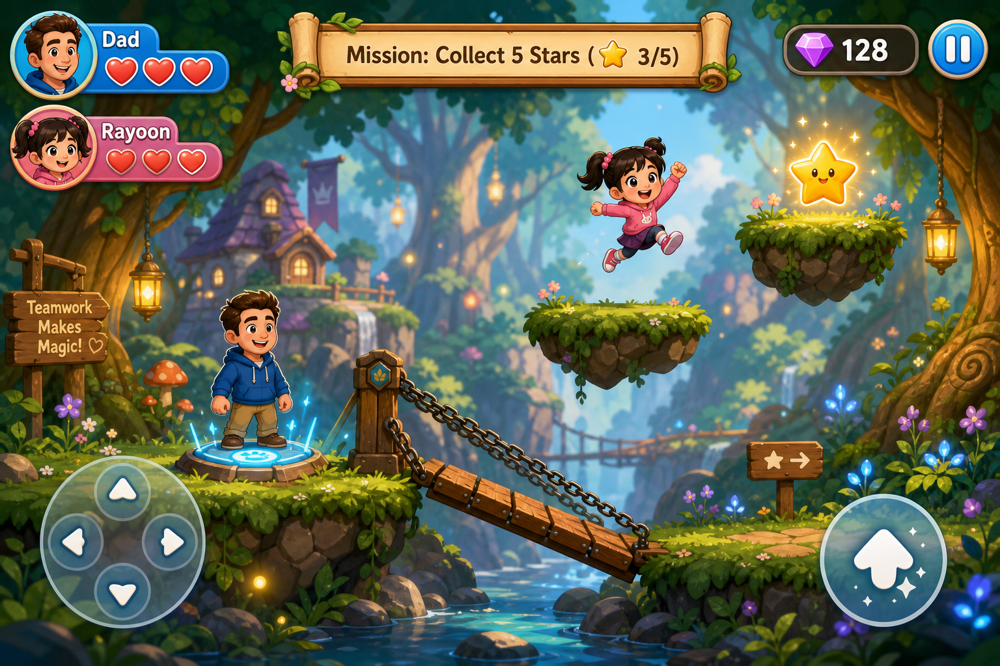

# 라윤 퀘스트 (Rayoon Quest) 🌟
> **아빠와 8살 딸 라윤이가 함께 즐기는 2인 협동 미션 플랫폼 게임**



## 🎮 게임 소개
- **장르:** 2인 협동 퍼즐 플랫폼 어드벤처
- **대상:** 아빠와 아이가 함께 같은 화면을 보며 클리어하는 가족 게임
- **기술 스택:** HTML5 Canvas, Vanilla JavaScript, Web Audio API (무설치 웹 브라우저 구동)

---

## 🕹️ 캐릭터 및 협동 기믹
| 캐릭터 | 주 역할 | 특징 및 능력 | PC 조작 |
| :--- | :--- | :--- | :--- |
| 👨 **아빠 (Dad)** | 기믹 활성화 / 길 만들기 | 힘이 세서 무거운 발판 스위치를 눌러 도개교 다리를 내림 | `A` `D` (이동), `W` (점프) |
| 👧 **라윤 (Rayoon)** | 별 수집 / 열쇠 획득 | 가볍고 날렵하여 **2단 점프** 가능, 높은 부유 섬 도달 | `←` `→` (이동), `↑` (2단 점프) |

- **스마트폰/태블릿 터치 지원:**
  - 화면 하단 가상 방향패드 및 점프 버튼
  - 상단 **[캐릭터 전환 🔄]** 버튼으로 1인 모드 시 아빠/라윤이 번갈아 조작 가능

---

## 🗺️ 챕터 1: 마법의 숲 미션
1. **아빠의 역할:** 계곡 건너편으로 가기 위해 왼쪽 언덕의 **파란 발판 스위치**를 밟고 서서 도개교 다리를 내립니다.
2. **라윤이의 역할:** 내려진 다리를 건너 부유 섬 곳곳에 흩어진 **황금별 5개(⭐)**를 2단 점프로 모두 모읍니다.
3. **골인:** 별을 모두 모으면 열리는 **황금빛 오두막 문(Goal)**으로 둘 다 함께 들어가면 미션 클리어!

---

## 🚀 로컬 실행 방법
1. 저장소 클론:
   ```bash
   git clone https://github.com/yuhan5491-dev/rayoon-quest.git
   cd rayoon-quest
   ```
2. `index.html` 파일을 크롬이나 사파리 등 브라우저로 열기만 하면 즉시 플레이 가능!
